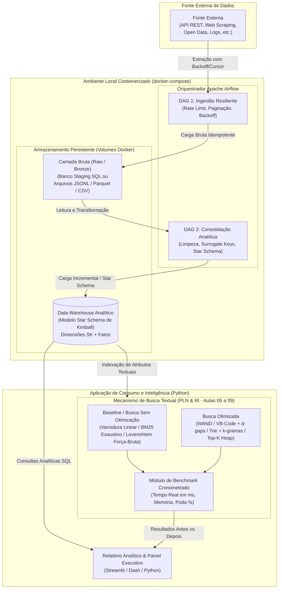
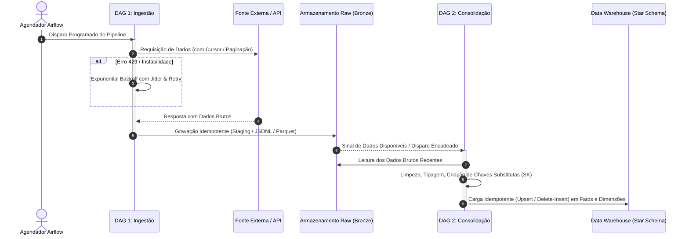
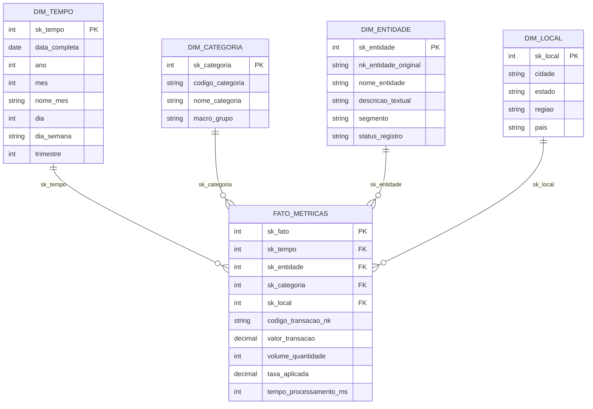
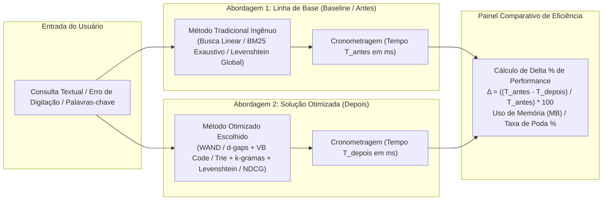

# Especificação do Trabalho Prático 2 (T2)
## Disciplinas: Modelagem Informacional & Processamento de Linguagem Natural e Sistemas de Recuperação de Informação
### Curso de Graduação em Ciência de Dados para Negócios — FUCAPE Business School
**Docente Responsável:** Prof. Dr. Wagner Perin  
**Semestre Letivo:** 2026 / 2º Bimestre  
**Artefato Oficial de Avaliação:** Trabalho Prático Final Integrado (T2)  
**Peso na Composição da Nota Bimestral (M2):** 
* **Modelagem Informacional:** 5,0 pontos
* **PLN e Sistemas de RI:** 3,0 pontos

**Formato de Trabalho:** Individual ou em Dupla

---

## 1. Visão Geral e Filosofia do Projeto

O objetivo principal do **Trabalho Prático 2 (T2)** é simular a construção completa de um produto analítico corporativo de dados em produção, conectando a modelagem analítica e a inteligência de recuperação de informação.

Os estudantes atuarão como **Engenheiros de Dados e Arquitetos de Soluções de Busca**, implementando uma esteira completa composta por:
1. **Infraestrutura Conteinerizada:** Provisionamento local do **Apache Airflow** e serviços correlatos utilizando `docker-compose`.
2. **Pipeline de Ingestão Resiliente (DAG 1):** Extração automatizada e salvamento de dados brutos (*Raw/Bronze*) com garantia de resiliência e tratamento de erros.
3. **Pipeline de Consolidação e Modelagem Dimensional (DAG 2):** Processamento e carga analítica em um banco de dados estruturado estritamente segundo os **princípios de Ralph Kimball** em **Modelo Estrela (*Star Schema*)**.
4. **Painel / Relatório Analítico Executivo em Python:** Interface funcional (ex.: Streamlit, Dash ou script analítico interativo) consumindo diretamente o Data Warehouse modelado.
5. **Mecanismo de Busca Textual Otimizado (PLN & RI):** Implementação de busca textual sobre os dados integrados, aplicando e comprovando experimentalmente uma das técnicas avançadas trabalhadas entre as **Aulas 05 e 09** de PLN & RI, com benchmark comparativo de desempenho cronometrado em milissegundos (*Antes vs. Depois*).

---

## 2. O Tema

> **Liberdade Temática Absoluta:** Vocês possuem **total autonomia** para definir o domínio de negócio, o tema e as fontes de dados para o seu pipeline de ETL.
> A única exigência é que a base de dados coletada possua um volume analítico razoável e contenha **atributos textuais ricos** (descrições, comentários, resumos, artigos, notícias, transcrições) suficientes para viabilizar as técnicas de busca textual de PLN & RI.
>### Exemplos de Domínios possíveis:
>* **Mercado Financeiro & Criptoativos:** Cotações históricas, dados de negociação e notícias/fatos relevantes (via APIs públicas como Yahoo Finance, CoinGecko, Banco Central, CVM).
>* **E-commerce & Catálogo de Produtos:** Produtos, preços, categorias e avaliações/reviews de clientes (via APIs públicas de varejo, Mercado Livre, FakeStore API ou scraping ético).
>* **Setor Imobiliário & Mobilidade Urbana:** Anúncios de imóveis, localizações, preços de m², metragem e descrições detalhadas de corretores.
>* **Saúde & Pesquisa Científica:** Artigos médicos da base PubMed, dados abertos do DataSUS, notificações sanitárias ou bulas de medicamentos.
>* **Governo, Dados Públicos e Transparência:** Gastos públicos, contratos de licitação, decisões judiciais ou proposições legislativas (via Portal da Transparência, dados abertos da Câmara/Senado).
>* **Entretenimento, Games e Streaming:** Filmes, sinopses, avaliações de usuários e métricas de bilheteria (via TMDb API, Steam API, Spotify API).
>* **Atendimento ao Cliente e Chamados de TI:** Tickets de suporte, categorias de incidentes, tempo de resolução e relatos textuais de problemas.

---

## 3. Arquitetura da Solução e Fluxo Integrado

A arquitetura completa do projeto deve seguir rigorosamente o fluxo ilustrado no diagrama abaixo:



---

## 4. Requisitos Técnicos Obrigatórios

### 4.1 Pilar de Engenharia e Orquestração (Apache Airflow & Docker)
1. **Provisionamento Conteinerizado com Docker Compose:**
   * O projeto deve conter um arquivo `docker-compose.yml` funcional na raiz ou na pasta `docker/`.
   * Deve subir o ambiente do Apache Airflow (Scheduler, Webserver, Triggerer e Banco de Metadados Postgres) na máquina local do aluno.
   * Os dados e as DAGs devem ser mapeados via **volumes Docker persistentes**, garantindo que reinicializações dos contêineres não causem perda dos dados coletados ou do Data Warehouse.
2. **DAG 1 — Ingestão Resiliente de Dados Brutos (*Raw / Bronze*):**
   * Coletar os dados da fonte escolhida de forma automatizada e programada.
   * Implementar **mecanismos de resiliência e polidez**:
     * Paginação robusta (por cursor ou offset dinâmico).
     * Tratamento de falhas de conexão e limites de tráfego (*Rate Limiting* / status `HTTP 429` ou instabilidades de rede) utilizando estratégias de retentativa com retardo progressivo (**Exponential Backoff**).
   * Salvar os dados em sua granularidade atômica e formato original bruto em uma área de armazenamento persistente:
     * *Opção A:* Tabelas de *staging* brutas em banco relacional (ex.: PostgreSQL, SQLite, MySQL).
     * *Opção B:* Arquivos planos em volume persistente (ex.: JSONL, CSV ou Parquet particionados).
   * **Garantia de Idempotência:** A reexecução do DAG para um mesmo período ou execução manual (*Clear Task / Retry*) não deve criar duplicidades caóticas na camada bruta.
3. **DAG 2 — Consolidação e Carga Analítica no Data Warehouse:**
   * Ler os dados brutos recém-armazenados pelo DAG 1.
   * Realizar limpeza, deduplicação, tratamento de tipos e desaninhamento de atributos.
   * Construir e popular as tabelas do **Data Warehouse Analítico**.
   * O disparo do DAG 2 deve ser encadeado ou agendado subsequentemente ao DAG 1 (via *Dataset Sensors*, *TriggerDagRunOperator* ou agendamento temporal harmônico).



---

### 4.2 Pilar de Modelagem Informacional
O banco de dados analítico de destino (Data Warehouse) deve ser implementado estritamente conforme a metodologia de **Modelagem Dimensional de Ralph Kimball**, estruturado em um **Modelo Estrela (*Star Schema*)**:

1. **Declaração Formal da Granularidade:** O relatório/código deve declarar explicitamente o que representa **uma linha da tabela fato** (ex.: *"Cada linha representa um produto vendido em uma transação"* ou *"Cada linha representa a cotação diária de fechamento de um ativo"*).
2. **Tabelas Dimensão (*Dimension Tables*):**
   * Conter atributos textuais, categóricos e contextuais desnormalizados para suporte a filtros e agrupamentos (`GROUP BY`).
   * **Uso Obrigatório de Chaves Substitutas (*Surrogate Keys - SK*):** Cada dimensão deve possuir uma chave primária sintética e artificial de tipo numérico inteiro ou hash (ex.: `sk_tempo`, `sk_produto`, `sk_cliente`, `sk_entidade`), totalmente desacoplada das chaves de negócio ou identificadores originais da fonte (*Natural Keys*).
   * Pelo menos uma dimensão temporal/calendário estruturada (com atributos como dia, mês, ano, dia da semana, trimestre).
3. **Tabela(s) Fato (*Fact Tables*):**
   * Conter as chaves estrangeiras apontando exclusivamente para as *Surrogate Keys* das tabelas dimensão associadas.
   * Conter atributos de métricas quantitativas de negócio:
     * Métricas totalmente aditivas (somáveis em qualquer corte, como quantidade, valor monetário, volume).
     * Opcionalmente métricas semi-aditivas ou contagens.
4. **Idempotência de Carga:** A carga analítica na tabela fato deve aplicar estratégias seguras (como *Delete-and-Insert* por partição de data ou comando `MERGE/UPSERT` com base em chaves compostas), garantindo que reexecuções não inflem as métricas de negócio.

#### Exemplo Conceitual de Arquitetura Star Schema:


---

### 4.3 Pilar de PLN e Sistemas de Recuperação de Informação

O projeto deve transcender a análise tradicional de números, incorporando **inteligência de busca textual** sobre os atributos descritivos do acervo integrado ao Data Warehouse.

1. **Implementação da Funcionalidade de Busca:**
   * A aplicação deve conter uma barra de busca (*Search Box*) permitindo ao usuário realizar consultas textuais por termos, entidades ou palavras-chave sobre o corpus.
2. **Seleção de Técnicas:**
   A equipe deve **escolher e implementar PELO MENOS UMA** das abordagens técnicas a seguir:
   * **Opção 1 — Compressão de Índice e Otimização de Memória:**
     * Implementação do índice invertido com compressão de listas de postagens utilizando **$d\text{-gaps}$** combinados com **Variable Byte Encoding (VB Code)** ou códigos bit-level (Elias-$\gamma$).
     * Comparar o desempenho e pegada em memória contra o armazenamento bruto com inteiros fixos padrão de 32/64 bits.
   * **Opção 2 — Ranqueamento Escalável Top-$K$ com Algoritmo de Poda WAND ou Min-Heap:**
     * Implementação do algoritmo de poda dinâmica segura **WAND (*Weak AND*)** ou uso de **Min-Heap Top-$K$** com **Champion Lists** para acelerar consultas sob modelos como BM25 ou TF-IDF.
     * Comparar contra o *baseline* de pontuação exaustiva (onde calcula-se o score BM25 para todos os documentos da base antes de ordenar).
   * **Opção 3 — Busca Tolerante a Falhas e Correção Ortográfica em 2 Estágios:**
     * Implementação de pipeline de busca tolerante: (Estágio 1) Triagem rápida via **Árvore Trie** para autocompletar de prefixos $O(|P|)$ ou **Índice Secundário de $k\text{-gramas}$ de caracteres** com **Coeficiente de Jaccard**; (Estágio 2) Refinamento da correção com a **Matriz de Distância de Edição de Levenshtein** via Programação Dinâmica restrita aos candidatos pré-selecionados.
     * Comparar o tempo de resposta contra uma varredura linear de Levenshtein em força-bruta sobre todo o vocabulário.
   * **Opção 4 — Avaliação Quantitativa Formal e Reranking Offline/Online (Aula 09):**
     * Implementação de um módulo rigoroso de avaliação comparando dois modelos de ranqueamento (ex.: BM25 vs. Modelo Vetorial Cosseno, ou com/sem expansão de consulta).
     * Cálculo de métricas rankeadas padronizadas: **Precision@K, MAP (Mean Average Precision) e NDCG (Normalized Discounted Cumulative Gain)** sobre um conjunto de consultas de teste anotadas, e/ou simulação de teste online via **Team Draft Interleaving** medindo distribuição de cliques sem viés posicional.



3. **Demonstração Experimental Obrigatória (Benchmark Antes vs. Depois):**
   * O código **deve medir o tempo real de execução** das consultas em milissegundos utilizando rotinas de alta precisão (ex.: `time.perf_counter()` em Python).
   * A interface/relatório deve exibir explicitamente a comparação:
     $$\text{Tempo do Baseline (Antes)} \quad \text{vs.} \quad \text{Tempo Otimizado (Depois)}$$
   * Apresentar o ganho percentual relativo de eficiência computacional:
     $$\Delta\% = \left( \frac{\text{Tempo}_{\text{Baseline}} - \text{Tempo}_{\text{Otimizado}}}{\text{Tempo}_{\text{Baseline}}} \right) \times 100$$
   * Caso tenham escolhido técnicas de compressão ou poda, apresentar também métricas de **economia de espaço/RAM (MB)** ou **taxa de poda (% de avaliações evitadas)**.

---

### 4.4 Pilar de Visualização
* Construção de uma interface analítica acessível (ex.: desenvolvida com **Streamlit**, **Dash**, **Gradio** ou um relatório analítico interativo executável em Python).
* O painel deve conectar-se ao Data Warehouse criado para apresentar:
  1. **Visão Analítica de Negócios:** Gráficos, métricas consolidadas (KPIs) e agregações temporais/categoriais extraídas diretamente das tabelas fato e dimensões do *Star Schema*.
  2. **Módulo Interativo de Busca Textual:** Caixa de consulta textual onde o usuário digita termos e vê os documentos/registros retornados ordenados por relevância.
  3. **Aba / Card de Engenharia e Benchmark:** Painel que exibe a medição de desempenho em tempo real (*Tempo Antes vs. Tempo Depois, Speedup $\times$, ganho percentual $\Delta\%$ e status de integridade dos pipelines*).

---

## 5. Estrutura Recomendada do Repositório Git

O trabalho deve ser entregue em um repositório GitHub público ou com acesso concedido ao professor (`wagnerperin`), organizado conforme os padrões profissionais da indústria:

```text
projeto-t2-fucape/
├── README.md                      # Documento executivo com arquitetura, instrução de execução e análise
├── docker-compose.yml             # Orquestração conteinerizada de todo o ambiente (Airflow, DBs, etc.)
├── .gitignore                     # Arquivos temporários, virtualenvs, dados brutos pesados
├── requirements.txt               # Dependências Python do projeto
│
├── dags/                          # DAGs do Apache Airflow
│   ├── dag_ingestao_raw.py        # DAG 1: Coleta, resiliência, backoff e armazenamento bruto
│   └── dag_consolidacao_dw.py     # DAG 2: Limpeza, Kimball Star Schema e carga analítica
│
├── src/                           # Código modular da aplicação
│   ├── ingestion/                 # Scripts auxiliares de conexão com APIs/Scraping
│   ├── warehouse/                 # DDLs SQL de criação do Star Schema e scripts de transformação
│   └── search_engine/             # Módulo de PLN e RI
│       ├── baseline.py            # Implementação da busca de referência (Antes)
│       ├── optimized.py           # Implementação da técnica avançada otimizada (Depois)
│       └── benchmark.py           # Funções de medição de tempo, memória e taxa de poda
│
├── app/                           # Aplicação interativa de visualização
│   └── app.py                     # Painel analítico executivo (Streamlit / Dash / Python)
│
└── docs/                          # Documentação complementar
    ├── arquitetura.md             # Diagramas e decisões arquiteturais de engenharia
    └── modelo_dimensional.md      # Dicionário de dados, granularidade e diagrama DER Star Schema
```

---

## 6. Conteúdo Obrigatório do Relatório / README.md

O arquivo `README.md` principal deve ser redigido como um relatório executivo-técnico, contendo as seguintes seções estruturadas:

1. **Identificação da Equipe:** Nomes completos dos integrantes e tema de negócio escolhido.
2. **Contexto de Negócio e Declaração da Dor:** Justificativa da escolha da base de dados, objetivos estratégicos das análises e relevância corporativa do pipeline.
3. **Arquitetura de Engenharia de Dados:**
   * Diagrama Mermaid ilustrando o fluxo dos dados desde a fonte até o Data Warehouse e o dashboard.
   * Explicação das estratégias de **resiliência de ingestão** (paginação, códigos HTTP tratados, retentativas e *Exponential Backoff*).
   * Demonstração formal de como a **Idempotência** foi assegurada em ambos os DAGs.
4. **Modelagem Dimensional:**
   * Declaração formal da **Granularidade da Tabela Fato**.
   * Diagrama Mermaid em formato Entidade-Relacionamento do **Modelo Star Schema** (tabelas fato e dimensões com suas respectivas *Surrogate Keys* inteiras).
   * Dicionário resumido de dados descrevendo o papel de cada métrica (aditiva, semiaditiva) e dimensão.
5. **Inteligência de Recuperação de Informação:**
   * Identificação das técnicas escolhidas para implementação.
   * Detalhamento conceitual e mecânica computacional do algoritmo implementado.
   * Descrição clara da **Linha de Base** utilizada para a comparação.
6. **Resultados Experimentais e Tabela de Benchmark:**
   * Tabela comparando medições com diferentes consultas de teste:
     * Tempo de execução médio do Baseline ($\text{ms}$).
     * Tempo de execução médio da Solução Otimizada ($\text{ms}$).
     * Redução percentual de tempo ($\Delta\%$) e fator de aceleração (*Speedup* $\times$).
     * Métricas auxiliares (quando aplicável: taxa de compressão de memória, taxa de documentos podados, precisão/NDCG).
   * Interpretação dos resultados alcançados.
7. **Guia Passo a Passo de Execução (*How-to-Run*):**
   * Instruções exatas e testadas para clonar o repositório, subir o ambiente via `docker compose up -d`, disparar as DAGs e inicializar o painel Python.

---

## 7. Critérios de Avaliação e Matriz de Rubricas

A avaliação do trabalho totalizará **10,0 pontos**, distribuídos entre os seguintes eixos avaliativos:

| Eixo Avaliativo | Peso | Critérios e Evidências Exigidas |
| :--- | :---: | :--- |
| **1. Orquestração e Resiliência (Airflow & Docker)** | **2,5 pts** | • `docker-compose.yml` funcional subindo Airflow e serviços de forma isolada e persistente.<br>• DAG 1 com tratamento de paginação, resiliência (*Backoff/Jitter*) e persistência bruta.<br>• DAG 2 com encadeamento adequado e garantia comprovada de **Idempotência** em reexecuções. |
| **2. Modelagem Dimensional (Ralph Kimball)** | **2,5 pts** | • Estruturação formal em **Modelo Star Schema** (Esquema Estrela).<br>• Declaração clara e precisa da **Granularidade da Fato**.<br>• Criação e uso estrito de **Chaves Substitutas (*Surrogate Keys*)** inteiras nas dimensões.<br>• Métricas de negócio quantitativas consistentes e relações integras entre fatos e dimensões. |
| **3. Mecanismo de Busca Textual & Benchmark (PLN & RI)** | **3,0 pts** | • Implementação funcional de técnica avançada lecionada entre as **Aulas 05 e 09**.<br>• Construção de um *Baseline* sólido para comparação (*Antes vs. Depois*).<br>• Medição cronometrada rigorosa em tempo real ($\text{ms}$) no código.<br>• Demonstração de ganho empírico expressivo de velocidade, compressão ou precisão. |
| **4. Aplicação Visual & Dashboard (Python)** | **1,0 pt** | • Interface gráfica interativa (Streamlit/Dash) conectada ao Data Warehouse.<br>• Exibição de KPIs e visualizações analíticas de negócio do Star Schema.<br>• Campo funcional de busca textual e painel de exibição dos tempos de benchmark. |
| **5. Engenharia de Software, Git e Documentação** | **1,0 pt** | • Organização modular e legível de código (PEP 8, separação de pastas).<br>• README.md completo com diagramas Mermaid, explicação técnica e instruções claras de reprodução.<br>• Histórico de commits no Git consistente e distribuído entre os integrantes. |
| **TOTAL** | **10,0 pts** | **Nota Global Integrada de T2** |

---

## 8. Prazos e Orientações para a Defesa

* **Data Final de Submissão:** 26/11/2026.
* **Forma de Submissão:** Envio do link do repositório no e-mail institucional wagnerperin@fucape.br.
* **Apresentação e Defesa Rápida:**
  * Até a data estipulada, cada equipe deverá enviar um video de no máximo **10 minutos** apresentando a solução funcionando ao vivo:
    1. *Demonstração da Web UI do Airflow:* Execução das duas DAGs com sucesso e auditoria das tarefas.
    2. *Demonstração do Data Warehouse:* Exibição da estrutura Star Schema no banco analítico.
    3. *Demonstração do Painel & Mecanismo de Busca:* Execução de consultas textuais ao vivo no painel e comprovação da diferença cronometrada do benchmark (*Antes vs. Depois*).
    4. *Arguição técnica:* Perguntas pontuais do professor a membros individuais da equipe sobre as decisões de engenharia, modelagem e algoritmos de busca adotados.

---

> *"Bons modelos analíticos resolvem o passado; boas esteiras de dados garantem o presente; e motores inteligentes de recuperação de informação antecipam o futuro."*  
> **Bom trabalho a todas as equipes!**
