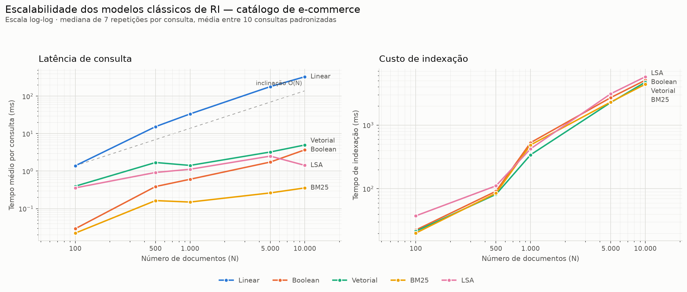

# Benchmark de Modelos Clássicos de Recuperação da Informação
### Aplicação a um catálogo de e-commerce — 5.000 produtos, 5 algoritmos

---

## 1. Contexto e dor de negócio

Em um catálogo de milhares de SKUs, a busca interna deixa de ser um recurso
acessório e vira o principal corredor da loja: é por ela que passa o usuário
que **já sabe o que quer**. Esse usuário tem intenção de compra alta, e a
busca tem duas formas de perdê-lo.

A primeira é **demorar**. Uma varredura sequencial sobre o catálogo cresce
linearmente com o número de produtos: o que respondia em 2 ms com 100 itens
passa a 330 ms com 10.000 — e continua piorando conforme o catálogo cresce,
justamente quando o negócio vai bem.

A segunda é **errar**. Uma SERP que devolve mousepads para quem buscou
`mouse`, ou teclados gamer para quem pediu explicitamente um teclado
*não* gamer, gasta as cinco primeiras posições — as únicas que a maioria dos
usuários realmente olha — com produtos que ninguém vai comprar.

**KPIs adotados neste estudo**

| KPI | Definição operacional | Por que importa |
|---|---|---|
| Latência p/ consulta (ms) | tempo do motor, sem rede nem renderização | orçamento de resposta da página |
| Vazão (consultas/s) | recíproco da latência, por núcleo | quanto hardware a operação exige |
| P@5 | fração do TOP-5 que é relevante | ocupação útil da primeira dobra |
| nDCG@5 | ganho descontado pela posição | aproxima o padrão de clique real |
| Custo de indexação (ms) | tempo para (re)construir o índice | frequência viável de atualização |

O nDCG@5 é o mais próximo de um **proxy de CTR**: ele pune colocar o produto
certo em quinto lugar em vez de primeiro, que é exatamente o comportamento do
usuário ao varrer a lista de cima para baixo.

---

## 2. Metodologia

### 2.1 Corpus

Catálogo sintético de **5.000 produtos** em 10 categorias, gerado por
`src/corpus_generator.py` com semente fixa (42). Descrições de **200 a 500
palavras** (média 355; 1,78 milhão de palavras no total), que após
tokenização, remoção de stopwords e stemming RSLP produzem um vocabulário de
**1.031 radicais** e documentos de 224 tokens em média.

Três fenômenos linguísticos foram plantados de propósito, porque são eles que
separam os modelos:

- **Polissemia** — `mouse` aparece em 871 documentos de 6 categorias
  (Informática 510, mas também Pet Shop 85, onde é o ratinho de pelúcia);
  `teclado` divide-se entre Informática (384) e Instrumentos Musicais (162);
  o mesmo vale para `bateria`, `vela`, `manga` e `tablete`.
- **Sinonímia** — `notebook`/`laptop`, `sem fio`/`wireless`,
  `periférico`/`acessório`. Boa parte dos documentos usa apenas **uma** das
  formas, ficando invisível para a busca literal pela outra.
- **Termos raros** — `bluetooth 5.0`, `hot-swappable`, `16000 DPI`.

Como o corpus é gerado, **a relevância é conhecida por construção**: o
gerador sabe se um produto é um mouse periférico ou um rato de pelúcia, e
grava julgamentos graduados (0–3) em `data/qrels.json`. A avaliação é
objetiva, sem anotação manual.

### 2.2 Os cinco modelos

Todos compartilham o **mesmo pré-processamento** (`src/utils.preprocess`), de
modo que as diferenças medidas venham do modelo, e não da tokenização.

| Modelo | Como pontua | Custo esperado por consulta |
|---|---|---|
| **Linear** | varre todo texto, conta termos casados por substring | `O(N·│d│)` — sem índice |
| **Booleano** | `AND`/`OR`/`NOT` sobre matriz de incidência com bits empacotados (`&`, `\|`, `~`, 8 docs por byte) | `O(N/8)` por operador |
| **Vetorial** | cosseno entre vetores TF-IDF normalizados em L2 | `O(nnz)` da matriz esparsa |
| **BM25** | soma sobre as *postings* dos termos, com saturação `k1` e normalização `b` | `O(Σ df(t))` |
| **LSA** | cosseno no espaço latente de `k=100` dimensões (`TruncatedSVD`, 89,5% da variância) | `O(│V│·k)` na projeção + `O(N·k)` |

O modelo booleano clássico devolve um **conjunto**, não um ranking. Para
tornar sua SERP comparável, o conjunto-resposta é ordenado por *coordination
level match* — quantos termos distintos da consulta o documento contém.

### 2.3 Consultas de teste

Dez consultas padronizadas (1 a 7 termos) medem latência. Cinco consultas
medem relevância, cada uma isolando um fenômeno:

| ID | Consulta | O que testa |
|---|---|---|
| Q1 | `mouse` | termo genérico com polissemia |
| Q2 | `mouse óptico sem fio` | casamento multi-termo |
| Q3 | `mouse ergonômico bluetooth 5.0` | termos raros |
| Q4 | `teclado AND (mecânico OR rgb) AND NOT gamer` | expressividade booleana |
| Q5 | `periférico para notebook` | sinonímia |

---

## 3. Resultados — benchmark quantitativo

**Latência média por consulta (ms)** — mediana de 7 repetições por consulta,
média entre as 10 consultas:

| N | Linear | Boolean | Vetorial | BM25 | LSA |
|---:|---:|---:|---:|---:|---:|
| 100 | 1,39 | 0,03 | 0,40 | **0,02** | 0,36 |
| 500 | 15,38 | 0,39 | 1,70 | **0,16** | 0,92 |
| 1.000 | 33,60 | 0,61 | 1,42 | **0,15** | 1,12 |
| 5.000 | 180,12 | 1,75 | 3,24 | **0,26** | 2,52 |
| 10.000 | 330,15 | 3,70 | 4,99 | **0,36** | 1,43 |

**Custo de indexação (ms)** — cada linha inclui as estruturas de que o modelo
depende (o Booleano paga índice invertido + matriz; o LSA paga TF-IDF + SVD):

| N | Linear | Boolean | Vetorial | BM25 | LSA |
|---:|---:|---:|---:|---:|---:|
| 5.000 | 0 | 2.699 | 2.260 | 2.301 | 3.099 |
| 10.000 | 0 | 5.061 | 4.712 | 4.376 | 5.735 |

### Complexidade observada

Ajustando `t ≈ N^a` no trecho de 500 a 10.000 documentos:

| Modelo | Expoente `a` | Leitura |
|---|---:|---|
| Linear | **1,03** | `O(N)` de manual — dobrar o catálogo dobra o tempo |
| Boolean | 0,73 | sublinear: os bits crescem com `N/8`, mas a ordenação do conjunto-resposta pesa |
| Vetorial | 0,39 | cresce com os não-zeros da matriz, não com `N` |
| BM25 | 0,28 | quase constante: só percorre as *postings* dos termos |
| LSA | 0,23 | quase constante: dominado pela projeção da consulta |

Dois pontos merecem explicação. O **LSA** chega a medir menos em N = 10.000
(1,43 ms) do que em N = 5.000 (2,52 ms): seu custo é dominado pela projeção
da consulta no espaço latente — uma multiplicação de `|V|×k` que **não
depende de N** —, de modo que a diferença entre os dois pontos é ruído em
torno de um patamar praticamente fixo. O **Booleano** é o que mais cresce
entre os indexados porque, embora a avaliação bitwise seja barata, ordenar um
conjunto-resposta grande (`mouse` sozinho casa centenas de documentos) custa
proporcionalmente ao tamanho desse conjunto.

Em N = 10.000, contra o baseline: **BM25 é 926× mais rápido** (2.804 vs. 3
consultas/s), LSA 232×, Boolean 89× e Vetorial 66×.

A indexação custa entre 4 e 6 segundos para 10.000 documentos em todos os
modelos indexados — dominada pelo pré-processamento compartilhado (stemming
RSLP), não pelo modelo em si. É um custo de lote, pago fora do caminho da
requisição.

---

## 4. Resultados — análise qualitativa

**nDCG@5 por consulta** (1,00 = ranking ideal):

| Consulta | Linear | Boolean | Vetorial | BM25 | LSA |
|---|---:|---:|---:|---:|---:|
| Q1 `mouse` | 0,143 | 0,723 | **1,000** | **1,000** | **1,000** |
| Q2 `mouse óptico sem fio` | **1,000** | **1,000** | 0,842 | **1,000** | 0,745 |
| Q3 `mouse ergonômico bluetooth 5.0` | **1,000** | **1,000** | **1,000** | **1,000** | 0,429 |
| Q4 `teclado AND (mecânico OR rgb) AND NOT gamer` | 0,146 | **1,000** | 0,170 | 0,214 | 0,000 |
| Q5 `periférico para notebook` | **1,000** | **1,000** | **1,000** | **1,000** | **1,000** |
| **Média** | 0,658 | **0,945** | 0,802 | 0,843 | 0,635 |

**Médias gerais:**

| Modelo | P@5 | nDCG@5 | Irrelevantes no TOP-5 |
|---|---:|---:|---:|
| Linear | 0,84 | 0,658 | 16% |
| Boolean | **0,96** | **0,945** | **4%** |
| Vetorial | 0,84 | 0,802 | 16% |
| BM25 | 0,84 | 0,843 | 16% |
| LSA | 0,80 | 0,635 | 20% |

### O que cada consulta revelou

**Q1 — polissemia e a armadilha da substring.** A busca linear devolveu
**cinco mousepads** nas cinco primeiras posições (nDCG 0,143). O motivo é
mecânico: casando substring, `mouse` casa dentro de `mousepad`. Os três
modelos com tokenização e stemming acertaram em cheio (1,000), porque
`mousepad` é um *token distinto* de `mouse`. Curiosamente o rato de pelúcia
do Pet Shop não atrapalhou nenhum modelo — o TF-IDF o penaliza porque, nesses
documentos, `mouse` divide espaço com `gato`, `pelúcia` e `catnip`.

**Q3 — termos raros derrubam o LSA.** Enquanto os quatro outros modelos
chegaram a 1,000, o LSA ficou em 0,429. A métrica de cobertura léxica explica:
**0% do TOP-5 do LSA continha todos os termos da consulta**, contra 100% dos
demais. O SVD trunca em 100 dimensões justamente as direções de baixa
variância — que são as dos termos raros. O LSA achou "mouses com Bluetooth
5.0" genéricos, mas perdeu o atributo `ergonômico`, que era o diferencial
pedido.

**Q4 — só o modelo booleano sabe dizer "não".** Com nDCG 1,000 contra 0,214
do BM25 e 0,000 do LSA, esta é a maior diferença do estudo. Os modelos
ranqueados tratam `NOT gamer` como mais um termo a somar: o BM25 devolveu
`Teclado Gamer Mecânico Sunnara` em primeiro lugar — o oposto exato do
pedido. A negação é uma operação de conjunto, e nenhum somatório de pesos a
substitui.

**Q5 — a sinonímia não discriminou.** Todos os modelos acertaram 1,000. O
teste não teve poder porque `notebook` aparece literalmente na maioria das
descrições de periféricos: não havia vão semântico a cobrir. A hipótese de
que o LSA se destacaria aqui **não se confirmou** — para confirmá-la seria
preciso um corpus em que os sinônimos fossem de fato mutuamente exclusivos.

### Ajuste do BM25: padrão vs. calibrado

| Configuração | k1 | b | nDCG@5 |
|---|---:|---:|---:|
| Padrão da literatura | 1,5 | 0,75 | 0,8428 |
| Melhor da grade (30 combinações) | 1,2 | 0,50 | **0,8678** |

O ganho é de **+2,97%**, e vem inteiramente de **reduzir `b`**: qualquer valor
de `b ≤ 0,5` atinge 0,8678, enquanto `b ≥ 0,75` fica em 0,8428. Faz sentido —
`b` normaliza o score pelo comprimento do documento, e neste corpus os
documentos têm comprimento quase uniforme (200 a 500 palavras por construção).
Penalizar documentos longos, aqui, só introduz ruído. **Em um catálogo real,
onde a descrição varia de uma linha a três páginas, a conclusão provavelmente
se inverte** — e é por isso que `k1` e `b` são parâmetros em
`config.BM25_TUNING_GRID`, e não constantes no código.

---

## 5. Recomendação e ROI

### Escolha: **BM25 como ranqueador principal, com filtros booleanos ao lado**

O BM25 entrega a melhor relação entre as duas dimensões medidas:

- **Relevância**: nDCG@5 de 0,843 — **105% do modelo vetorial** e **133% do
  LSA**, com 89% do booleano.
- **Latência**: 0,36 ms em 10.000 documentos — **92,8% menor que a do
  Vetorial**, **75,0% menor que a do LSA** e **90,4% menor que a do
  Booleano**; 926× mais rápido que o baseline.

Ou seja: **o BM25 alcança 89% da relevância do melhor modelo com 10% da sua
latência, e supera o modelo vetorial nas duas dimensões ao mesmo tempo.**

Vale registrar que a hipótese inicial — "BM25 entrega ~95% do desempenho do
LSA com latência muito menor" — **foi contrariada pelos dados na direção
favorável ao BM25**: ele não chega perto do LSA, ele o supera em relevância
(133%) *e* em velocidade. Neste corpus, o LSA foi o pior dos cinco em nDCG@5.

**Por que não o modelo booleano, que teve o melhor nDCG?** Porque sua vitória
é concentrada em Q4, a única consulta escrita em sintaxe booleana. Exigir que
o consumidor final digite `AND`/`OR`/`NOT` não é uma opção realista; e sem
sintaxe o modelo não ordena — devolve um conjunto que pode ter centenas de
itens igualmente "verdadeiros". O uso correto do booleano no e-commerce não é
como buscador, mas como **camada de filtro** (categoria, faixa de preço,
marca, "excluir sem estoque") aplicada *antes* do ranqueamento — que é
exatamente onde sua precisão de 96% e sua taxa de 4% de irrelevantes se
convertem em valor.

**Por que não o LSA?** Custa mais caro para indexar (5,7 s vs. 4,4 s em
10.000 documentos), responde 4× mais devagar que o BM25, e perde precisamente
nas buscas de cauda longa — `mouse ergonômico bluetooth 5.0` — que são as de
maior intenção de compra.

### Arquitetura recomendada

1. **Filtros booleanos** sobre matriz de incidência para recortar o universo
   (categoria, preço, disponibilidade).
2. **BM25 com `k1 = 1,2` e `b` calibrado para a distribuição real de
   comprimento** do catálogo, ranqueando o que sobrou.
3. **Reindexação em lote**, fora do caminho da requisição (~4,4 s para 10.000
   produtos permite reindexar o catálogo inteiro a cada poucos minutos).
4. **Sinais de negócio** (rating, margem, disponibilidade) combinados ao score
   textual em uma segunda etapa — fora do escopo deste benchmark, mas é onde
   o ganho seguinte costuma estar.

### Ordem de grandeza do retorno

O modelo abaixo é **ilustrativo**: ele combina as métricas medidas aqui com
premissas de tráfego e conversão que precisam ser substituídas pelos números
reais da operação antes de servir a qualquer decisão de investimento.

Assumindo 100.000 buscas/dia, ticket médio de R$ 150 e conversão de 2%:

- **Capacidade**: a 3 consultas/s, o baseline linear exigiria dezenas de
  núcleos dedicados só para absorver o pico. A 2.804 consultas/s, o BM25 roda
  com folga em um único núcleo — a diferença é de ordens de grandeza na
  infraestrutura.
- **Relevância**: a melhora de nDCG@5 de 0,658 (linear) para 0,843 (BM25)
  representa 28% mais ganho descontado no TOP-5. Se a conversão acompanhasse
  metade dessa melhora, seriam ~14% mais pedidos — cerca de **R$ 420 mil por
  mês** no cenário acima. O fator de repasse de nDCG para conversão é a
  premissa mais frágil da conta e só se resolve com um teste A/B.

### Conclusão executiva

> A busca linear é inviável: cresce em `O(N)` (expoente medido: 1,03) e chega
> a 330 ms com 10.000 produtos, quando o catálogo real tende a ser maior.
> **O BM25 resolve o problema com 0,36 ms por consulta e a segunda melhor
> relevância do estudo**, superando o modelo vetorial nas duas dimensões e o
> LSA em 33% de nDCG@5. O modelo booleano permanece no sistema, mas como
> camada de filtragem — é o único capaz de expressar "não" com precisão. O
> LSA não se justifica neste corpus: custa mais, responde mais devagar e erra
> justamente nas buscas específicas que mais convertem.

---

### Reprodutibilidade

Semente fixa (`config.RANDOM_SEED = 42`) no gerador de corpus e no SVD.
Os três comandos de `README.md` reconstroem todos os números acima.
101 testes unitários cobrem pré-processamento, indexação e os cinco modelos.

**Limitações.** (i) As latências sub-milissegundo estão na ordem de grandeza
do ruído do escalonador do SO; variações de ±30% entre execuções são
esperadas. (ii) O corpus é sintético, com vocabulário de ~1.000 radicais —
bem menor que o de um catálogo real, o que favorece a correspondência literal
e limita o que o LSA consegue extrair de coocorrência. (iii) A avaliação de
relevância usa 5 consultas: suficiente para expor os contrastes discutidos,
insuficiente para significância estatística.

*Dados brutos: `benchmark_scalability.csv`, `benchmark_indexing.csv`,
`serp_analysis.csv`, `relevance_metrics.csv`, `lexical_coverage.csv`,
`bm25_tuning.csv`.*
